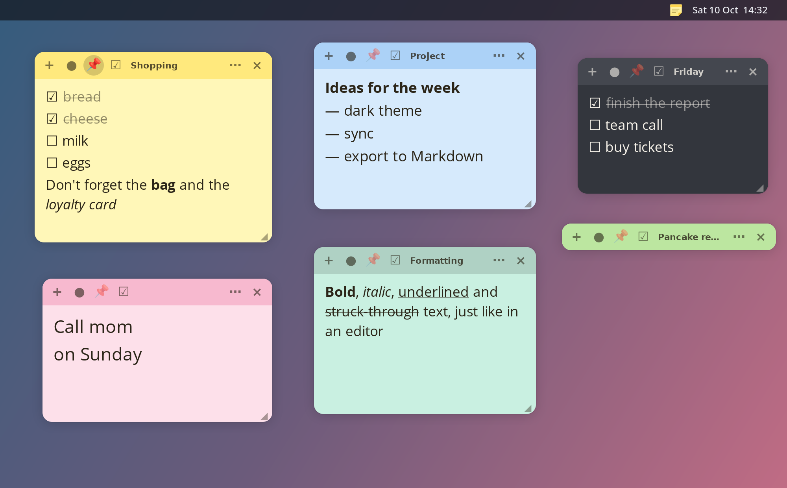
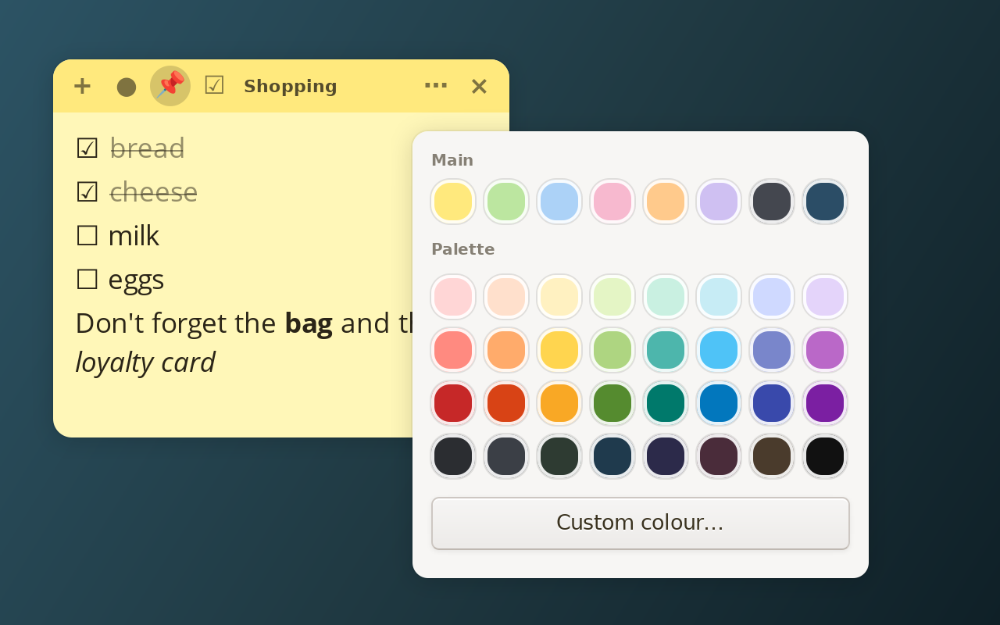
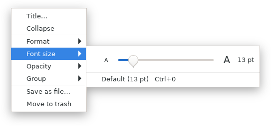
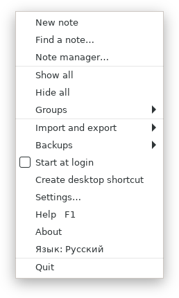
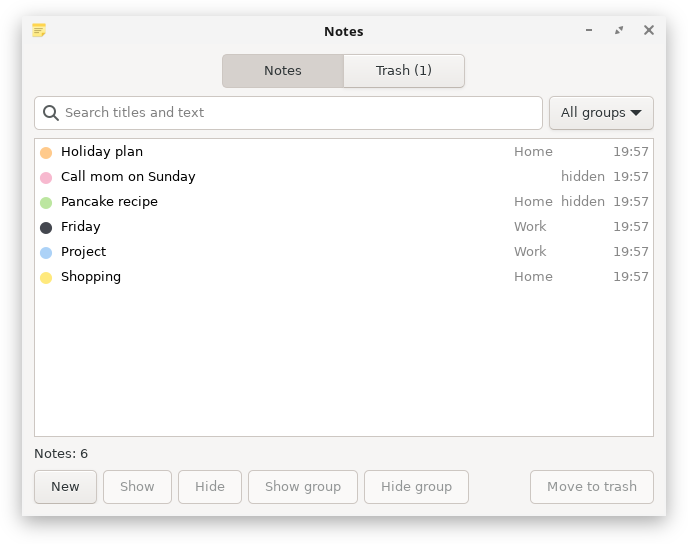
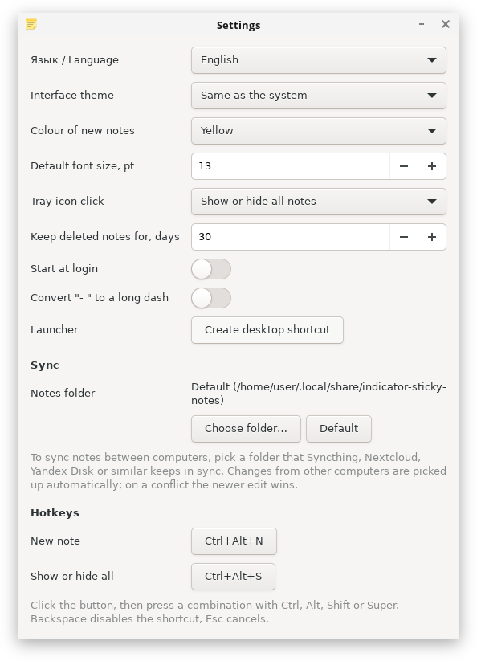

<div align="center">

<a href="README.md"></a>
&nbsp;
<a href="README.ru.md"></a>

<br><br>


# Sticky Notes

**Coloured sticky notes for the Linux desktop.**<br>
Checklists, formatting, groups, trash, sync between computers and a tray icon.<br>
The interface is available in **English and Russian** and switches in one click.

[](https://github.com/h0r1ze/Linux-indicator-sticky-notes/actions/workflows/ci.yml)
[](https://github.com/h0r1ze/Linux-indicator-sticky-notes/releases/latest)
[](LICENSE)




</div>

A Python and GTK3 app with no extra dependencies. The idea comes from [Sticky](https://github.com/linuxmint/sticky) in Linux Mint, but this is an independent implementation and no code from the original was used.

**Works on:** Debian, Ubuntu, Linux Mint, Fedora, RHEL and its clones (AlmaLinux, Rocky, RED OS), Arch Linux (Manjaro, EndeavourOS), openSUSE, Alpine, Void and any other distribution with Python 3.9+ and GTK 3. The tests, the installer and the packages are checked in containers of these systems on every change.

## Quick start

The universal way, works on any distribution (installs only for you, no root needed except for GTK from your package manager):

```bash
git clone https://github.com/h0r1ze/Linux-indicator-sticky-notes.git
cd Linux-indicator-sticky-notes
./install.sh
indicator-sticky-notes
```

`install.sh` finds your package manager (apt, dnf, yum, pacman, zypper, apk, xbps), installs GTK 3 and PyGObject if they are missing, and puts the app into `~/.local`. Remove it with `./install.sh --uninstall` (your notes stay).

Or take a ready package from the [releases page](https://github.com/h0r1ze/Linux-indicator-sticky-notes/releases/latest):

| System | Package | Command |
|---|---|---|
| Debian, Ubuntu, Linux Mint | `.deb` | `sudo apt install ./indicator-sticky-notes_*_all.deb` |
| Fedora, RHEL, AlmaLinux, Rocky, RED OS | `.rpm` (take the one for your system: `fc` Fedora, `el9` RHEL 9 and clones, `red80` RED OS 8) | `sudo dnf install ./indicator-sticky-notes-*.noarch.rpm` |
| Arch Linux, Manjaro, EndeavourOS | `.pkg.tar.zst` | `sudo pacman -U indicator-sticky-notes-*.pkg.tar.zst` |
| Anything else | source | `./install.sh`, or `./run.sh` to run without installing |

A tray icon appears: a click hides or shows all notes, a right click opens the menu.

> **GNOME note.** GNOME does not show tray icons by default. Install the "AppIndicator and KStatusNotifierItem Support" extension, or simply use the notes' own menu: `⋯` → **Sticky Notes** contains everything the tray menu has (manager, settings, help, language, quit).

## Language

The interface speaks **English and Russian**. By default the app follows the system language. To change it:

- tray menu → **Language: English / Язык: Русский** (one click), or
- **Settings → Язык / Language**.

The app restarts by itself and your notes stay where they were.

## Features

### Colour and design



- Rounded sheets with a soft shadow and a coloured header
- 8 main colours (two of them dark), a **designer palette of 32 shades** and a "Custom colour…" editor
- The text, icon and selection colours are **picked automatically for the background**: light text on a dark sheet, contrast at least 4.5 (WCAG AA)
- Dark interface theme, sheet opacity, and a separate font size for every note

<br clear="right">

### Write the way you like

- **Formatting:** bold `Ctrl+B`, italic `Ctrl+I`, underline `Ctrl+U`, strikethrough `Ctrl+Shift+X`. Shortcuts work in any keyboard layout
- **Checkboxes:** the ☑ button or `Ctrl+L`, typing `[ ] ` becomes ☐, Enter continues the list, a click on the box ticks it and finished items are struck through
- **Word-style dash lists:** type `-` and `Tab` (autoconversion of `- ` plus space can be switched on in the settings; by default a hyphen stays a hyphen). Enter continues the list (on an empty item it goes up a level or ends the list), `Tab` and `Shift+Tab` indent and outdent (up to three levels), Backspace right after the marker removes it. Wrapped lines align under the text
- **Title**, **keep on top** (📌), **collapse** with a double click on the header
- Font size: a **slider right in the menu** `⋯` → "Font size" (the mark on the track is the default size), plus `Ctrl++`, `Ctrl+-`, `Ctrl+0` or `Ctrl` + mouse wheel

<div align="center">

&nbsp;&nbsp;&nbsp;

</div>

### Keep things in order



- **Note manager:** search titles and text, filter by group, select several notes (`Ctrl+A`, `Delete`); matches are highlighted in the note itself
- **Groups:** sort notes into groups and show or hide a whole group at once
- **Trash:** deleted notes stay for 30 days (configurable) and can be restored; empty notes are deleted at once

<br clear="right">

### Your data is safe

- **Backups:** automatic once a day, manual to any place you choose, and restore from a file (a separate backup is made before restoring)
- **Sync between computers:** pick a folder that Syncthing, Nextcloud, Yandex Disk and the like keep in sync. Edits are picked up automatically, the newer edit wins on a conflict, and window positions stay per computer
- **Export** to Markdown (with formatting and checkboxes) and to `.txt`; **import** from `.txt`, `.md`, backups and **Mint Sticky**
- A damaged notes file is never overwritten: it is set aside

### Settings, help and hotkeys



| Action | Shortcut |
|---|---|
| New note from anywhere | `Ctrl+Alt+N` |
| Show or hide all notes | `Ctrl+Alt+S` |
| Help | `F1` |

The built-in **help** (`F1`, or "Help" and "About" in the tray menu) describes every feature and shortcut. Global shortcuts can be changed in the settings. They work in an X11 session; under Wayland an app cannot grab keys outside its own windows, everything else works as usual.

The settings also hold: language, theme, colour and font of new notes, the tray click action, trash retention, start at login, autoconversion of `- ` to a long dash, the sync folder and a **"Create desktop shortcut"** button.

<br clear="right">

## Installation details

**Debian, Ubuntu, Linux Mint.** A ready package is on the [releases page](https://github.com/h0r1ze/Linux-indicator-sticky-notes/releases/latest), or build it yourself (needs only `dpkg-deb`):

```bash
./packaging/build-deb.sh
sudo apt install ./build/indicator-sticky-notes_*_all.deb
```

**Fedora, RHEL, AlmaLinux, RED OS.** The spec and build script live in `packaging/` (needs `rpm-build`, `python3-devel`, `python3-rpm-macros`, `python3-setuptools`):

```bash
./packaging/build-rpm.sh
sudo dnf install ./build/indicator-sticky-notes-*.noarch.rpm
```

The package is `noarch` (pure Python, any CPU), but it is tied to the Python version of the system it was built on, so use the file for your distribution or build it yourself.

**Arch Linux, Manjaro.** Build with `makepkg` (needs `base-devel` and `python-build python-installer python-setuptools python-wheel`; do not run as root):

```bash
./packaging/build-arch.sh
sudo pacman -U ./build/indicator-sticky-notes-*.pkg.tar.zst
```

**From source** you need GTK 3 and PyGObject (Debian/Ubuntu/Mint: `python3-gi gir1.2-gtk-3.0`, Fedora/RHEL/RED OS: `python3-gobject gtk3`, Arch: `python-gobject gtk3`, openSUSE: `python3-gobject typelib-1_0-Gtk-3_0`):

```bash
./run.sh                 # run
./create-shortcut.sh     # launcher in the project folder and in the applications menu
```

The app runs as a single instance: starting it again just shows the notes. To run an updated version, quit the old one first (tray → "Quit").

## Where the data lives

| What | Where |
|---|---|
| Notes | `~/.local/share/indicator-sticky-notes/notes.json` (or the chosen sync folder) |
| Automatic backups | `~/.local/share/indicator-sticky-notes/backups/` |
| Settings | `~/.config/indicator-sticky-notes/settings.json` |

Before version 0.2.3 the package was called `indicat-sticky-notes` (a typo). On the first start of the new version your notes, settings and autostart entry are moved over from the old folders automatically, and the `.deb`, `.rpm` and Arch packages replace the old package.

## For developers

Logic is covered by plain tests, the interface (including real hotkey presses through XTest) by tests in a virtual X server:

```bash
xvfb-run -a python3 -m unittest discover -s tests -t .   # everything, 220+ tests
python3 -m unittest discover -s tests -t .               # without a display GUI tests are skipped
./tools/smoke.sh indicator-sticky-notes                  # does the installed app start?
```

The CI runs the tests and the installer on Debian, Ubuntu, Fedora, AlmaLinux, Arch Linux and openSUSE, and builds, installs and starts the `.deb`, `.rpm` and Arch packages.

Translations live in `indicator_sticky_notes/translations_en.py` (the Russian strings in the code are the keys); a test checks that every marked string has an English version. Screenshots for both languages are rebuilt with `./tools/make_screenshots.sh` (needs `xvfb-run`, `marco`, ImageMagick and pycairo).


## License

[MIT](LICENSE)
