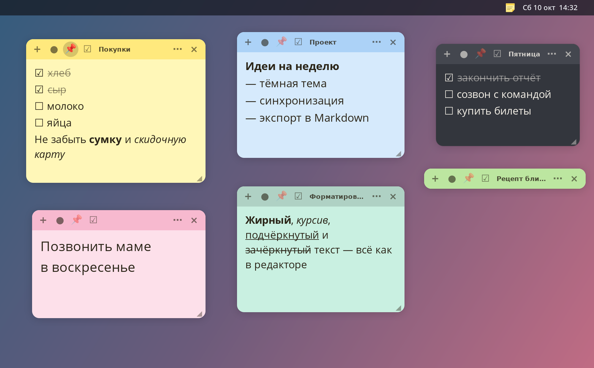
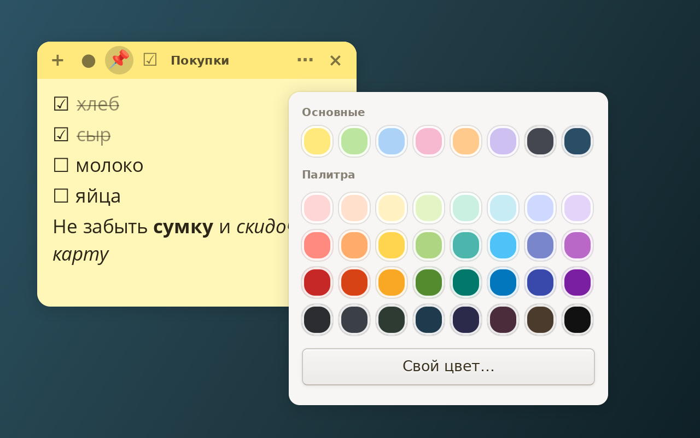
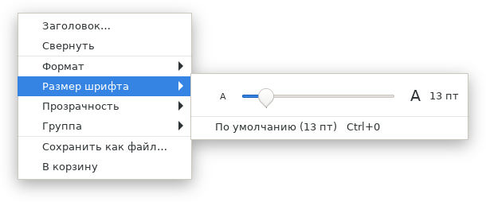
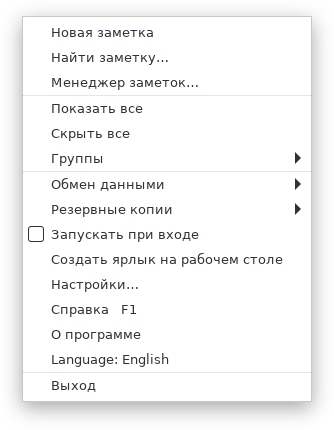
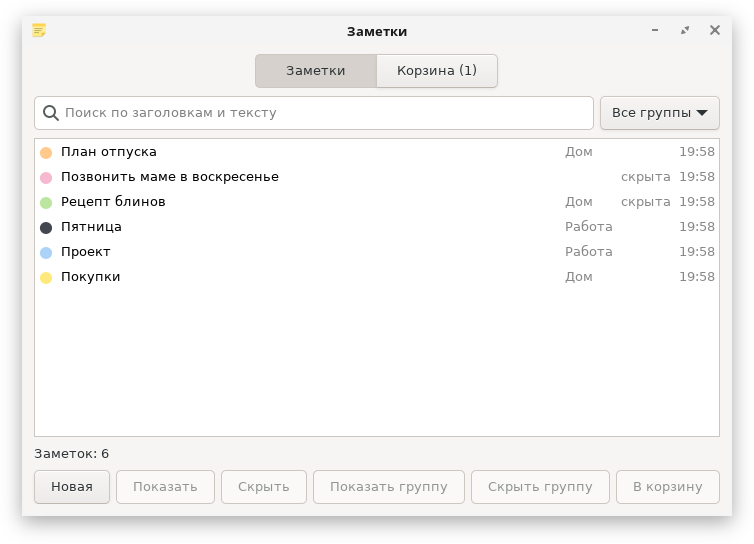
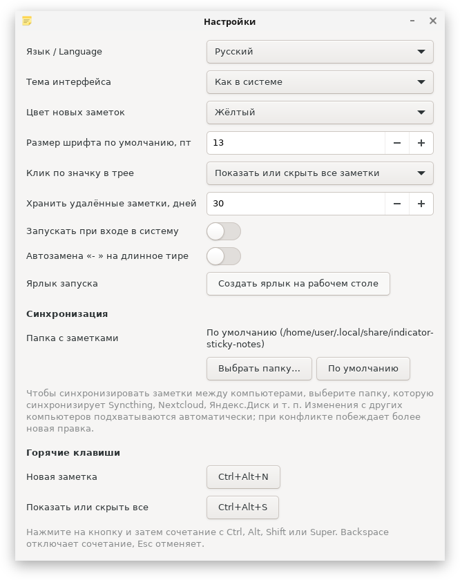

<div align="center">

<a href="README.md"></a>
&nbsp;
<a href="README.ru.md"></a>

<br><br>


# Стикеры

**Цветные заметки на рабочем столе Linux.**<br>
Чекбоксы, форматирование, группы, корзина, синхронизация между компьютерами и иконка в трее.<br>
Интерфейс на **русском и английском**, язык переключается в один щелчок.

[](https://github.com/h0r1ze/Linux-indicator-sticky-notes/actions/workflows/ci.yml)
[](https://github.com/h0r1ze/Linux-indicator-sticky-notes/releases/latest)
[](LICENSE)




</div>

Приложение на Python и GTK3 без лишних зависимостей. Идея навеяна [Sticky](https://github.com/linuxmint/sticky) из Linux Mint, но это независимая реализация, код оригинала не использовался.

**Работает на:** Debian, Ubuntu, Linux Mint, Fedora, RHEL и клонах (AlmaLinux, Rocky, RED OS), Arch Linux (Manjaro, EndeavourOS), openSUSE, Alpine, Void и любом другом дистрибутиве с Python 3.9+ и GTK 3. Тесты, установщик и пакеты проверяются в контейнерах этих систем при каждом изменении.

## Быстрый старт

Универсальный способ, подходит для любого дистрибутива (ставится только для вас, root нужен лишь для GTK из пакетного менеджера):

```bash
git clone https://github.com/h0r1ze/Linux-indicator-sticky-notes.git
cd Linux-indicator-sticky-notes
./install.sh
indicator-sticky-notes
```

`install.sh` сам находит пакетный менеджер (apt, dnf, yum, pacman, zypper, apk, xbps), доустанавливает GTK 3 и PyGObject, если их нет, и кладёт программу в `~/.local`. Удалить: `./install.sh --uninstall` (заметки остаются).

Или возьмите готовый пакет на [странице релизов](https://github.com/h0r1ze/Linux-indicator-sticky-notes/releases/latest):

| Система | Пакет | Команда |
|---|---|---|
| Debian, Ubuntu, Linux Mint | `.deb` | `sudo apt install ./indicator-sticky-notes_*_all.deb` |
| Fedora, RHEL, AlmaLinux, Rocky, RED OS | `.rpm` | `sudo dnf install ./indicator-sticky-notes-*.noarch.rpm` |
| Arch Linux, Manjaro, EndeavourOS | `.pkg.tar.zst` | `sudo pacman -U indicator-sticky-notes-*.pkg.tar.zst` |
| Всё остальное | исходники | `./install.sh` или `./run.sh` (запуск без установки) |

Значок появится в системном трее: клик скрывает и показывает все заметки, правая кнопка открывает меню.

> **GNOME.** По умолчанию GNOME не показывает значки в трее. Поставьте расширение «AppIndicator and KStatusNotifierItem Support» или просто пользуйтесь меню самой заметки: `⋯` → **Стикеры** содержит всё, что есть в меню трея (менеджер, настройки, справка, язык, выход).

## Язык интерфейса

Интерфейс **русский и английский**. По умолчанию язык берётся из системы. Сменить его можно так:

- меню трея → **Язык: Русский / Language: English** (один щелчок) или
- **Настройки → Язык / Language**.

Приложение само перезапустится, заметки останутся на своих местах.

## Возможности

### Цвет и дизайн



- Скруглённые листы с мягкой тенью и цветной шапкой
- 8 основных цветов (два тёмных), **дизайнерская палитра из 32 оттенков** и «Свой цвет…» с редактором
- Цвет текста, иконок и выделения **подбирается под фон автоматически**: на тёмном листе текст светлый, контраст не ниже 4.5 (WCAG AA)
- Тёмная тема интерфейса, прозрачность листа, размер шрифта у каждой заметки свой

<br clear="right">

### Пишите как удобно

- **Форматирование:** жирный `Ctrl+B`, курсив `Ctrl+I`, подчёркнутый `Ctrl+U`, зачёркнутый `Ctrl+Shift+X`. Сочетания работают и в русской раскладке
- **Чекбоксы:** кнопка ☑ или `Ctrl+L`, набор `[ ] ` превращается в ☐, Enter продолжает список, клик по квадратику ставит галочку, выполненные пункты зачёркиваются
- **Списки с длинным тире, как в Word:** наберите `-` и `Tab` (автозамену по `- ` и пробелу можно включить в настройках; по умолчанию дефис остаётся дефисом), Enter продолжает список (на пустом пункте выносит на уровень выше или заканчивает список), `Tab` и `Shift+Tab` вкладывают пункт глубже и выше (до трёх уровней), Backspace сразу за маркером убирает его. Перенесённые строки выравниваются под текстом
- **Заголовок** заметки, **закрепление** поверх всех окон (📌), **сворачивание** двойным щелчком по шапке
- Размер шрифта: **ползунок прямо в меню** `⋯` → «Размер шрифта» (отметка на дорожке — размер по умолчанию), а также `Ctrl++`, `Ctrl+-`, `Ctrl+0` или `Ctrl` + колесо мыши

<div align="center">

&nbsp;&nbsp;&nbsp;

</div>

### Порядок в заметках



- **Менеджер заметок:** поиск по заголовкам и тексту, фильтр по группам, выбор нескольких заметок (`Ctrl+A`, `Delete`), найденное подсвечивается в самой заметке
- **Группы:** раскладывайте заметки по группам и показывайте или скрывайте группу целиком
- **Корзина:** удалённые заметки хранятся 30 дней (настраивается) и восстанавливаются; пустые заметки удаляются сразу

<br clear="right">

### Ваши данные в безопасности

- **Резервные копии:** автоматически раз в сутки, вручную в любое место по вашему выбору, восстановление из файла (перед восстановлением делается отдельная копия)
- **Синхронизация между компьютерами:** выберите в настройках папку, которую синхронизирует Syncthing, Nextcloud, Яндекс.Диск и т. п. Правки подхватываются автоматически, при конфликте побеждает более новая; положение окон у каждого компьютера своё
- **Экспорт** в Markdown (с форматированием и чекбоксами) и в `.txt`; **импорт** из `.txt`, `.md`, копий и **Mint Sticky**
- Повреждённый файл заметок не затирается, а откладывается в сторону

### Настройки, справка и горячие клавиши



| Действие | Сочетание |
|---|---|
| Новая заметка из любого места | `Ctrl+Alt+N` |
| Показать или скрыть все заметки | `Ctrl+Alt+S` |
| Справка | `F1` |

Встроенная **справка** (`F1`, а также пункты «Справка» и «О программе» в меню значка) описывает все возможности и сочетания клавиш. Глобальные сочетания меняются в настройках. Они работают в сеансе X11; в Wayland приложение не может перехватывать клавиши вне своих окон, остальные функции работают как обычно.

В настройках также: язык, тема, цвет и шрифт новых заметок, действие по клику на значок, срок хранения корзины, автозапуск при входе, автозамена «- » на длинное тире, папка синхронизации и кнопка **«Создать ярлык на рабочем столе»**.

<br clear="right">

## Подробности установки

**Debian, Ubuntu, Linux Mint.** Готовый пакет на странице [релизов](https://github.com/h0r1ze/Linux-indicator-sticky-notes/releases/latest), или соберите сами (нужны `python3-setuptools` и `dpkg-deb`):

```bash
./packaging/build-deb.sh
sudo apt install ./build/indicator-sticky-notes_*_all.deb
```

**Fedora, RHEL, AlmaLinux, RED OS.** Spec и скрипт сборки лежат в `packaging/` (нужны `rpm-build`, `python3-devel`, `python3-rpm-macros`, `python3-setuptools`):

```bash
./packaging/build-rpm.sh
sudo dnf install ./build/indicator-sticky-notes-*.noarch.rpm
```

Пакет `noarch` (чистый Python), он ставится на x86_64 и другие архитектуры.

**Arch Linux, Manjaro.** Сборка через `makepkg` (нужны `base-devel` и `python-build python-installer python-setuptools python-wheel`; не запускайте от root):

```bash
./packaging/build-arch.sh
sudo pacman -U ./build/indicator-sticky-notes-*.pkg.tar.zst
```

**Из исходников** понадобятся GTK 3 и PyGObject (Debian/Ubuntu/Mint: `python3-gi gir1.2-gtk-3.0`, Fedora/RHEL/RED OS: `python3-gobject gtk3`, Arch: `python-gobject gtk3`, openSUSE: `python3-gobject typelib-1_0-Gtk-3_0`):

```bash
./run.sh                 # запуск
./create-shortcut.sh     # ярлык в корне проекта и в меню приложений
```

Приложение работает в одном экземпляре: повторный запуск просто показывает заметки. Чтобы запустить обновлённую версию, сначала завершите старую (трей → «Выход»).

## Где лежат данные

| Что | Где |
|---|---|
| Заметки | `~/.local/share/indicator-sticky-notes/notes.json` (или выбранная папка синхронизации) |
| Автоматические копии | `~/.local/share/indicator-sticky-notes/backups/` |
| Настройки | `~/.config/indicator-sticky-notes/settings.json` |

До версии 0.2.3 пакет назывался `indicat-sticky-notes` (опечатка). При первом запуске новой версии заметки, настройки и автозапуск переносятся из старых папок сами, а `.deb`, `.rpm` и пакет для Arch заменяют старый пакет.

## Для разработчиков

Логика проверяется обычными тестами, интерфейс (включая настоящие нажатия горячих клавиш через XTest) в виртуальном X-сервере:

```bash
xvfb-run -a python3 -m unittest discover -s tests -t .   # всё, 220+ тестов
python3 -m unittest discover -s tests -t .               # без дисплея GUI-тесты пропускаются
./tools/smoke.sh indicator-sticky-notes                  # запускается ли установленная программа?
```

CI гоняет тесты и установщик на Debian, Ubuntu, Fedora, AlmaLinux, Arch Linux и openSUSE, а пакеты `.deb`, `.rpm` и для Arch собирает, ставит и запускает.

Переводы лежат в `indicator_sticky_notes/translations_en.py` (ключ — русская строка из кода); тест проверяет, что у каждой помеченной строки есть английский вариант. Скриншоты для обоих языков пересобираются командой `./tools/make_screenshots.sh` (нужны `xvfb-run`, `marco`, ImageMagick и pycairo).


## Лицензия

[MIT](LICENSE)
